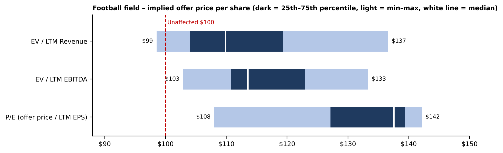

# Precedent Transaction Analysis – ABCD Tech | Excel

A precedent transaction (deal comps) valuation of **ABCD Tech**, a hypothetical technology target, using multiples paid in **7 comparable acquisitions (2023–2025)**. The model estimates the implied enterprise value, offer price per share and control premium. Units are USD millions unless stated.

## Build
- **Target data:** $100 unaffected price (30-day VWAP), 250mm diluted shares, $750mm net debt, LTM revenue $5,200mm, LTM EBITDA $1,000mm, LTM EPS $1.80
- **Deal multiples:** EV/LTM revenue, EV/LTM EBITDA and offer price/LTM EPS for each deal, with minimum, 25th percentile, median, mean, 75th percentile and maximum
- **Implied ranges:** enterprise value → equity value (less net debt) → offer price per share → control premium over the unaffected price
- **Charts tab:** deal multiples, football field of implied offer price, and control premium by method, all linked to the model
- **PDF report** with findings, tables and charts

## Key findings
- Median deal multiples: **5.4x EV/revenue**, **29.1x EV/EBITDA** and **76.4x P/E**
- Implied enterprise value at median multiples: **$28,219mm–$29,133mm**
- Interquartile offer price across the three methods: **$104–$139 per share** vs a $100 unaffected price
- Median implied control premium: **10%** (revenue), **14%** (EBITDA), **38%** (P/E)
- EV/EBITDA gives the narrowest range of the EV methods ($111–$123 interquartile)

## Files
- `Precedent_Transaction_Analysis.xlsx`
- `Precedent_Transaction_Analysis_Report.pdf`
- `football_field.png`

## Tools
MS Excel (MEDIAN, QUARTILE.INC, valuation multiples, charts) · PDF report

## Note
ABCD Tech and the seven deals are an anonymised training case, not real company data. For learning purposes only, not investment advice.

## Author
**Aditya Kushwaha** · [LinkedIn](https://www.linkedin.com/in/aditya-kushwaha16)
